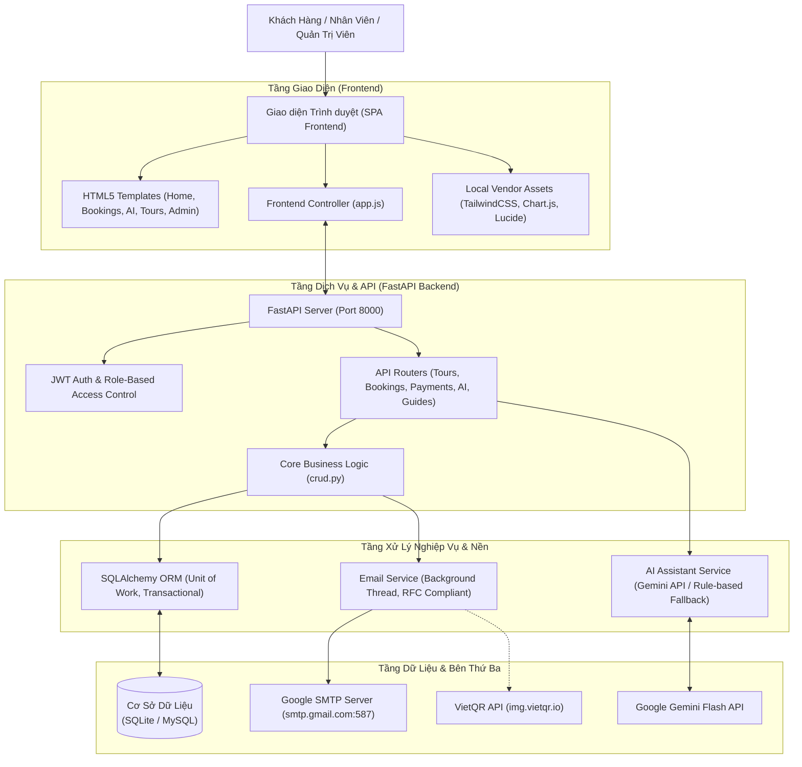
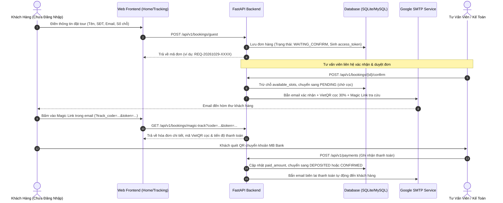

# Kiến Trúc Hệ Thống VietJourney AI (ARCHITECTURE.md)

VietJourney AI được xây dựng theo mô hình **Compound AI System (Hệ thống AI Phức hợp)** kết hợp giữa ứng dụng Web quản lý nghiệp vụ lữ hành truyền thống và Trợ lý Trí tuệ Nhân tạo hỗ trợ tư vấn, vận hành.

---

## 1. Sơ Đồ Kiến Trúc Tổng Thể

---

## 2. Luồng Nghiệp Vụ Đặt Tour & Thanh Toán Cọc (Booking & Deposit Flow)

---

## 3. Các Phân Hệ Dữ Liệu Chính

| Bảng dữ liệu | Mục đích | Ràng buộc chính |
| :--- | :--- | :--- |
| **`tours`** | Danh mục tuyến tour | `code` UNIQUE, `base_price` >= 0 |
| **`departures`** | Lịch khởi hành theo ngày | `available_slots` <= `total_seats`, trạng thái `OPEN / FULL / RUNNING / COMPLETED / CANCELLED` |
| **`customers`** | Hồ sơ khách hàng | `phone` UNIQUE, tự động cập nhật `email` và `full_name` khi đặt tour mới |
| **`bookings`** | Đơn đặt tour | `booking_code` UNIQUE, `access_token` UNIQUE 64-char dùng cho Magic Link, `deposit_amount` = 30% |
| **`payments`** | Sổ cái thanh toán | `amount` > 0, `transaction_code` UNIQUE per booking |
| **`users`** | Tài khoản nhân sự | Mật khẩu hash bcrypt, phân quyền `admin / consultant / accountant / guide` |
