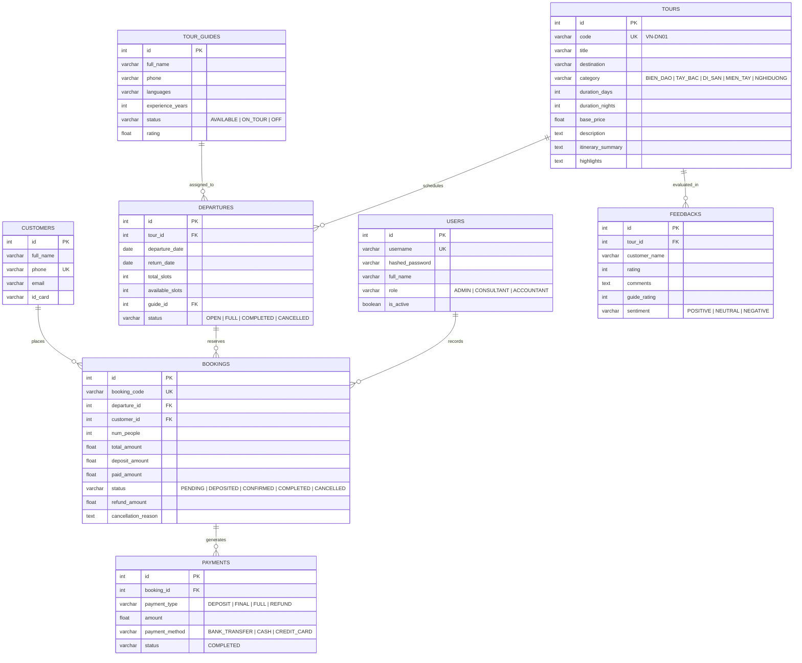

# BÁO CÁO KT1: PHÂN TÍCH YÊU CẦU & THIẾT KẾ HỆ THỐNG
## DỰ ÁN: HỆ THỐNG QUẢN LÝ TOUR DU LỊCH CÓ TÍCH HỢP AI (VIETJOURNEY AI)

---

## 1. Mô tả bài toán & Bối cảnh thực tế

Trong ngành du lịch lữ hành, việc quản lý thông tin thủ công thường gặp nhiều nút thắt cổ chai:
1. **Quản lý tour và lịch khởi hành**: Dễ dẫn đến tình trạng bán vượt số chỗ cho phép (**Overbooking**), gây xung đột chỗ ngồi và mất uy tín với khách hàng.
2. **Tư vấn lịch trình khách hàng**: Nhân viên mất nhiều thời gian đọc lại từng tour để tìm kiếm chuyến đi phù hợp với ngân sách, sở thích và số ngày của khách.
3. **Biên tập nội dung mô tả**: Nhân sự marketing tiêu tốn hàng giờ đồng hồ để soạn thảo bài viết tiếp thị và tóm tắt lịch trình từng ngày cho mỗi tour mới.
4. **Phân tích chất lượng dịch vụ**: Khách hàng để lại nhiều đánh giá nhưng ban quản trị không thể đọc hết từng nhận xét để rút ra điểm mạnh/yếu của hướng dẫn viên và tuyến điểm.

**Giải pháp**: Xây dựng phần mềm quản lý tập trung trên nền tảng Web FastAPI + SQLite, tích hợp mô hình trí tuệ nhân tạo (AI Engine) để tự động hóa khâu tư vấn khách hàng (grounded theo tour còn chỗ), sinh nội dung quảng bá và tóm tắt phản hồi chất lượng tour.

---

## 2. Xác định Tác nhân (Actors) & Phân quyền (RBAC)

Hệ thống phân chia rõ 3 nhóm tác nhân chính:
- **Quản lý (Admin)**: Toàn quyền quản trị hệ thống, quản lý danh mục tour, tài khoản nhân viên, xem báo cáo doanh thu tổng và phân tích chiến lược.
- **Nhân viên tư vấn (Consultant / Sales)**: Tìm kiếm tour, sử dụng Chatbot AI tư vấn tour cho khách theo ngân sách, tạo đơn đặt chỗ (Booking), ghi nhận thông tin khách hàng.
- **Kế toán (Accountant)**: Theo dõi các đợt thanh toán, xác nhận tiền đặt cọc (30%), thu nốt số tiền còn lại, duyệt hoàn tiền theo chính sách khi có yêu cầu hủy tour.

---

## 3. Sơ đồ Ca Sử Dụng (Use Case Diagram)

```mermaid
graph TD
    subgraph Users ["Tác nhân người dùng"]
        Admin["Quản Trị Viên (Admin)"]
        Consultant["Nhân Viên Tư Vấn"]
        Accountant["Kế Toán Viên"]
        Customer["Khách Hàng (Web Portal)"]
    end

    subgraph System ["Hệ Thống VietJourney AI"]
        UC1["UC-01: Đăng nhập & Chuyển quyền (RBAC)"]
        UC2["UC-02: Quản lý Tour & Lịch trình (CRUD)"]
        UC3["UC-03: Mở đợt khởi hành & Giám sát chỗ trống"]
        UC4["UC-04: Đặt tour & Trừ chỗ tự động (Chống overbooking)"]
        UC5["UC-05: Thu tiền cọc & Thanh toán đợt cuối"]
        UC6["UC-06: Hủy tour & Tính tiền hoàn cọc tự động"]
        UC7["UC-07: Phân công Hướng dẫn viên"]
        UC8["UC-08: Gửi phản hồi & Đánh giá sau chuyến đi"]
        UC9["UC-09: AI Tư vấn tour theo ngân sách/thời gian"]
        UC10["UC-10: AI Sinh mô tả & Lịch trình từng ngày"]
        UC11["UC-11: AI Tóm tắt đánh giá & Cảm xúc khách hàng"]
        UC12["UC-12: Báo cáo Doanh thu & Tỷ lệ lấp đầy"]
    end

    Admin --> UC1
    Admin --> UC2
    Admin --> UC3
    Admin --> UC6
    Admin --> UC7
    Admin --> UC11
    Admin --> UC12

    Consultant --> UC1
    Consultant --> UC3
    Consultant --> UC4
    Consultant --> UC9
    Consultant --> UC10

    Accountant --> UC1
    Accountant --> UC5
    Accountant --> UC6
    Accountant --> UC12

    Customer --> UC4
    Customer --> UC8
    Customer --> UC9
```

---

## 4. Đặc tả Quy trình Nghiệp vụ Then chốt

### 4.1. Quy trình Đặt tour & Giữ chỗ (Booking Workflow)
1. Khách hàng hoặc Nhân viên tư vấn chọn Tour và Đợt khởi hành mong muốn.
2. Hệ thống kiểm tra số chỗ còn trống (`available_slots`):
   - Nếu `available_slots < num_people`: Báo lỗi HTTP 400 và chặn giao dịch (Chống Overbooking).
   - Nếu `available_slots >= num_people`: Trừ số chỗ ngay lập tức (`available_slots -= num_people`).
3. Nếu `available_slots == 0`, hệ thống tự động đổi trạng thái đợt khởi hành sang `FULL`.
4. Tính toán tổng tiền tour = `base_price * num_people`.
5. Yêu cầu đặt cọc tối thiểu **30%** giá trị đơn hàng để xác nhận trạng thái `DEPOSITED`.

### 4.2. Quy trình Hủy tour & Hoàn tiền (Cancellation & Refund Policy)
1. Khách hàng thông báo hủy chuyến hoặc nhân viên tiếp nhận yêu cầu.
2. Hệ thống khôi phục lại số chỗ trống cho đợt khởi hành (`available_slots += num_people`).
3. Nếu đợt khởi hành đang ở trạng thái `FULL`, chuyển về trạng thái `OPEN`.
4. Hệ thống kiểm tra số ngày còn lại tính từ ngày hiện tại đến ngày khởi hành (`departure_date - today`):
   - **>= 15 ngày**: Hoàn trả **100%** số tiền khách đã đóng.
   - **7 đến 14 ngày**: Hoàn trả **70%** số tiền đã đóng (phạt 30%).
   - **3 đến 6 ngày**: Hoàn trả **50%** số tiền đã đóng (phạt 50%).
   - **< 3 ngày**: Không hoàn tiền (**0%**) do sát ngày khởi hành.
5. Tạo phiếu chi hoàn tiền (`REFUND`) trong sổ cái kế toán và chuyển trạng thái booking sang `CANCELLED`.

---

## 5. Thiết kế Cơ sở Dữ liệu (Entity Relationship Diagram - ERD)

