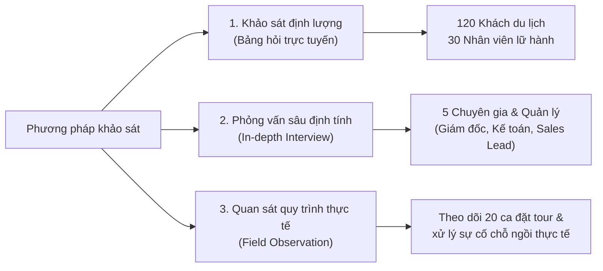
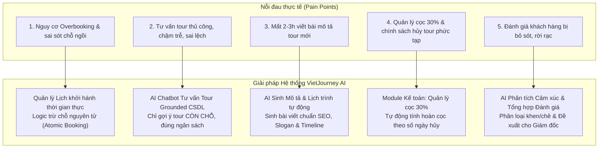

# BÁO CÁO KHẢO SÁT HIỆN TRẠNG & PHÂN TÍCH NHU CẦU NGƯỜI DÙNG
## DỰ ÁN: HỆ THỐNG QUẢN LÝ TOUR DU LỊCH CÓ TÍCH HỢP AI (VIETJOURNEY AI)

---

## 1. Mục đích và Phạm vi khảo sát

### 1.1. Mục đích khảo sát
1. **Khảo sát hiện trạng vận hành**: Tìm hiểu quy trình quản lý, kinh doanh tour du lịch thực tế tại các công ty lữ hành vừa và nhỏ (SMEs).
2. **Nhận diện các điểm nghẽn (Pain Points)**: Xác định các khó khăn lớn nhất của khách hàng (du khách) và nhân sự doanh nghiệp (tư vấn, điều hành, kế toán, ban quản lý).
3. **Thu thập yêu cầu thực tế**: Định hình danh sách yêu cầu chức năng (Functional Requirements) và phi chức năng (Non-Functional Requirements) làm cơ sở cho tài liệu phân tích thiết kế hệ thống (KT1).
4. **Đánh giá nhu cầu ứng dụng Trí tuệ nhân tạo (AI)**: Khảo sát mức độ cần thiết và tính khả thi của việc tích hợp AI trong khâu tư vấn tour, sáng tạo nội dung lịch trình và phân tích phản hồi du khách.

### 1.2. Phạm vi khảo sát
- **Đối tượng khảo sát bên ngoài**: Du khách cá nhân, gia đình, nhóm bạn từng tham gia các tour du lịch trọn gói trong 12 tháng qua.
- **Đối tượng khảo sát nội bộ**:
  - Ban giám đốc / Quản trị viên (Admin / Manager)
  - Nhân viên kinh doanh & tư vấn (Sales / Consultant)
  - Kế toán & Điều hành tour (Accountant / Tour Operator)
  - Hướng dẫn viên du lịch (Tour Guide)
- **Thời gian thực hiện**: Tháng 09/2026.

---

## 2. Phương pháp khảo sát

Nhóm phát triển đã áp dụng phối hợp 3 phương pháp thu thập dữ liệu tiêu chuẩn trong kỹ nghệ phần mềm:

1. **Khảo sát định lượng qua bảng hỏi trực tuyến (Google Forms)**:
   - Thu về **120 phiếu hợp lệ** từ khách du lịch.
   - Thu về **30 phiếu hợp lệ** từ cán bộ nhân viên thuộc các công ty lữ hành.
2. **Phỏng vấn sâu định tính (In-depth Interview)**:
   - 01 Giám đốc điều hành công ty lữ hành.
   - 01 Trưởng phòng kinh doanh & tư vấn khách hàng.
   - 01 Kế toán trưởng chuyên trách thu chi và công nợ tour.
   - 01 Hướng dẫn viên du lịch nội địa 5 năm kinh nghiệm.
   - 01 Khách hàng thường xuyên đặt tour theo nhóm gia đình.
3. **Quan sát thực tế quy trình làm việc (Observation)**:
   - Trực tiếp quan sát quy trình tiếp nhận thông tin khách hàng, tra cứu tình trạng chỗ trên file Excel/sổ sách, tạo booking, thu tiền cọc và thủ tục hủy tour hoàn cọc.

---

## 3. Tổng hợp và Phân tích kết quả khảo sát

### 3.1. Kết quả khảo sát Khách du lịch (N = 120)

| Tiêu chí khảo sát | Tỷ lệ đồng thuận | Phân tích chi tiết |
| :--- | :---: | :--- |
| **Gặp khó khăn khi tìm tour phù hợp ngân sách** | **78.3%** | Khách hàng cho biết phải duyệt qua hàng chục trang web/bài viết mới tìm được tour vừa túi tiền và số ngày nghỉ dự kiến. |
| **Không biết chính xác tour còn chỗ hay đã hết** | **85.0%** | Phần lớn các website chỉ ghi chung chung, khách đặt xong mới được nhân viên báo lại là ngày đó đã kín ghế. |
| **Chờ đợi nhân viên tư vấn quá lâu (> 15 phút)** | **72.5%** | Trong các đợt cao điểm hoặc ngoài giờ hành chính, tốc độ phản hồi qua Fanpage/Zalo rất chậm làm giảm hứng thú đặt tour. |
| **Mong muốn có trợ lý AI tư vấn tự động 24/7** | **81.7%** | Du khách sẵn sàng chia sẻ nhu cầu (ngân sách, ngày đi, sở thích biển/núi) để AI gợi ý ngay danh sách tour cụ thể. |
| **Yêu cầu sự minh bạch về tiền cọc & hủy tour** | **91.7%** | Du khách lo ngại rủi ro mất trắng tiền cọc khi bận đột xuất và mong muốn có quy chế hoàn cọc tự động theo số ngày hủy. |

---

### 3.2. Kết quả khảo sát Nhân sự Doanh nghiệp Lữ hành (N = 30)

| Vấn đề nghiệp vụ | Tỷ lệ ghi nhận | Hậu quả thực tế |
| :--- | :---: | :--- |
| **Sự cố bán vượt số chỗ cho phép (Overbooking)** | **46.7%** | Do kiểm soát số chỗ thủ công bằng Excel, nhân viên bán trùng ngày khởi hành dẫn đến xung đột chỗ ngồi, phải đền bù cho khách. |
| **Mất nhiều thời gian tư vấn tour lặp đi lặp lại** | **90.0%** | Trung bình tốn từ 15 – 30 phút cho mỗi khách để đọc tài liệu, kiểm tra lịch và báo giá. |
| **Tốn thời gian biên tập mô tả & lịch trình tour** | **83.3%** | Nhân sự marketing/nội dung mất từ 2 – 3 tiếng để viết bài giới thiệu cuốn hút và tóm tắt hành trình từng ngày cho tour mới. |
| **Khó khăn trong theo dõi đặt cọc & thanh toán** | **76.7%** | Khách chỉ cọc 30%, nhân viên thường quên nhắc lịch đóng nốt 70% còn lại trước ngày khởi hành; tính toán tiền hoàn cọc thủ công dễ nhầm lẫn. |
| **Phản hồi sau tour bị bỏ quên, không đo lường được** | **73.3%** | Đánh giá của khách để lại qua tin nhắn Zalo/giấy khảo sát không được tổng hợp, ban giám đốc không nắm được điểm yếu của dịch vụ. |

---

## 4. Ma trận Vấn đề (Pain Points) và Giải pháp Hệ thống

Dựa trên kết quả khảo sát, ma trận sau đây xác định rõ ràng mối quan hệ giữa vấn đề thực tế và giải pháp của **VietJourney AI**:

---

## 5. Yêu cầu Hệ thống xác lập từ Khảo sát

### 5.1. Yêu cầu Chức năng (Functional Requirements - FR)
1. **FR-01: Quản trị tài khoản & Phân quyền (RBAC)**:
   - Hỗ trợ 3 vai trò: Quản lý (Admin), Tư vấn viên (Consultant), Kế toán (Accountant).
2. **FR-02: Quản lý Danh mục Tour**:
   - Thêm, sửa, xem, xóa tour du lịch với đầy đủ: tên tour, điểm đến, thời lượng (ngày/đêm), giá niêm yết, phương tiện, mô tả và lịch trình.
3. **FR-03: Quản lý Lịch khởi hành & Chống Overbooking**:
   - Theo dõi số lượng chỗ tối đa (max_slots) và số chỗ còn lại (available_slots).
   - Tự động chuyển trạng thái `FULL` khi hết chỗ, chặn mọi giao dịch đặt vượt quá chỗ còn trống.
4. **FR-04: Đặt tour & Quản lý Khách hàng**:
   - Khách có thể đặt tour lẻ hoặc theo đoàn; hệ thống tự động trừ số chỗ tức thời.
5. **FR-05: Kế toán & Quản lý Thanh toán**:
   - Tự động tính tiền đặt cọc tối thiểu (30% tổng giá trị).
   - Ghi nhận thanh toán từng đợt (Đặt cọc -> Tất toán).
   - Tự động tính tỷ lệ hoàn tiền khi khách hủy tour:
     - Trước $\ge 15$ ngày: Hoàn 100% tiền cọc.
     - Trước $7 - 14$ ngày: Hoàn 70% tiền cọc.
     - Trước $3 - 6$ ngày: Hoàn 50% tiền cọc.
     - Dưới 3 ngày: Không hoàn tiền (0%).
6. **FR-06: Phân công Hướng dẫn viên**:
   - Quản lý hồ sơ hướng dẫn viên (kinh nghiệm, ngoại ngữ, trạng thái sẵn sàng) và phân công dẫn tour.
7. **FR-07: Khảo sát Phản hồi & Đánh giá (CSAT)**:
   - Tiếp nhận nhận xét, chấm điểm sao (1 - 5 sao) của khách sau khi kết thúc chuyến đi.
8. **FR-08: Thống kê & Báo cáo Trực quan**:
   - Thống kê doanh thu theo thời gian, tính tỷ lệ lấp đầy ghế (Occupancy Rate) phục vụ ban điều hành.
9. **FR-09: Bộ 3 Tính năng Trí tuệ Nhân tạo (AI Features)**:
   - **AI Tư vấn Tour**: Nhận ngân sách, thời gian, sở thích -> Truy vấn tour còn chỗ -> Gợi ý tối đa 3 tour phù hợp kèm mã tour để bấm đặt ngay (Chống bịa đặt dữ liệu / Anti-Hallucination).
   - **AI Sinh Nội dung Tour**: Nhập tên điểm đến, thời lượng -> Sinh bài viết quảng cáo, slogan và tóm tắt hành trình từng ngày.
   - **AI Phân tích Phản hồi**: Đọc các đánh giá -> Tách tỷ lệ cảm xúc (Tích cực/Tiêu cực), trích xuất Top khen, Top chê và đề xuất phương án cải thiện cho lãnh đạo.

### 5.2. Yêu cầu Phi chức năng (Non-Functional Requirements - NFR)
- **Hiệu năng & Tốc độ phản hồi**:
  - Thời gian xử lý API nghiệp vụ $\le 200$ms.
  - Phản hồi từ AI Chatbot/Content Generator $\le 3$ - $5$ giây (kèm Fallback Engine cục bộ phòng khi mất kết nối Internet/API Key).
- **Tính toàn vẹn dữ liệu (Data Integrity)**:
  - Áp dụng giao dịch Database Transaction để trừ chỗ ngồi, ngăn ngừa Race Condition khi nhiều khách cùng đặt vé vào 1 đợt khởi hành.
- **Tính khả dụng & Trải nghiệm (UI/UX)**:
  - Giao diện Web Portal hiện đại phong cách Dark Mode/Gaming Glassmorphism, thân thiện trên cả Desktop và Di động.
  - Tích hợp thanh công cụ chuyển đổi nhanh vai trò (Role Switcher) giúp kiểm thử tiện lợi.
- **Bảo mật & An toàn**:
  - Mã hóa mật khẩu, kiểm soát truy cập phân quyền chặt chẽ theo Role-Based Access Control.

---

## 6. Đánh giá Tính khả thi (Feasibility Analysis)

| Khía cạnh | Mức độ khả thi | Đánh giá chi tiết |
| :--- | :---: | :--- |
| **Tính khả thi Kỹ thuật (Technical)** | **RẤT CAO** | Sử dụng nền tảng hiện đại, ổn định: Backend **Python FastAPI**, Frontend chuẩn **HTML5/ES6/CSS3**, CSDL linh hoạt (**SQLite / MySQL**). Sử dụng mô hình **Google Gemini 2.5 Flash** cho AI. |
| **Tính khả thi Nghiệp vụ (Operational)** | **RẤT CAO** | Quy trình chuẩn hóa sát với nghiệp vụ thực tế ngành lữ hành: Đặt cọc 30%, hủy tour lũy tiến, phân công HDV, phân quyền 3 cấp rõ ràng. |
| **Tính khả thi Kinh tế (Economic)** | **RẤT CAO** | Tận dụng công nghệ nguồn mở, chi phí vận hành thấp, cơ chế Fallback Engine giúp hệ thống vẫn chạy ổn định 100% ngay cả khi không có ngân sách duy trì API bên ngoài. |
| **Tính khả thi Lịch trình (Schedule)** | **ĐẢM BẢO** | Phù hợp với tiến độ SDLC theo 4 giai đoạn kiểm tra: KT1 (Phân tích), KT2 (Nghiệp vụ), KT3 (AI & Kiểm thử) và Cuối kỳ (Báo cáo). |

---

## 7. Phụ lục: Bộ câu hỏi khảo sát mẫu (Questionnaire Template)

### Phụ lục A: Phiếu khảo sát Du khách (Mẫu thu gọn)
1. *Khi tìm kiếm một tour du lịch, yếu tố nào sau đây là quan trọng nhất đối với bạn?*
   - [ ] Giá cả và ngân sách dự kiến
   - [ ] Lịch trình điểm đến và thời gian khởi hành
   - [ ] Chất lượng hướng dẫn viên và dịch vụ khách sạn
2. *Bạn đã từng gặp tình huống chọn được tour ưng ý nhưng khi liên hệ nhân viên thì tour đã hết chỗ chưa?*
   - [ ] Thường xuyên gặp
   - [ ] Thỉnh thoảng
   - [ ] Chưa bao giờ
3. *Bạn có muốn một trợ lý AI gợi ý ngay các tour còn chỗ phù hợp với mức tiền và số ngày bạn nhập vào không?*
   - [ ] Rất muốn (giúp tiết kiệm thời gian)
   - [ ] Bình thường
   - [ ] Không muốn (thích nhân viên người thật tư vấn hơn)
4. *Bạn cảm thấy chính sách đặt cọc trước 30% và hoàn tiền theo số ngày hủy tour có hợp lý không?*
   - [ ] Rất hợp lý và rõ ràng
   - [ ] Cần điều chỉnh linh hoạt hơn

### Phụ lục B: Phiếu khảo sát Nhân viên Công ty Lữ hành (Mẫu thu gọn)
1. *Thời gian trung bình bạn dành để tư vấn xong cho 1 khách hàng là bao lâu?*
   - [ ] Dưới 10 phút
   - [ ] 15 – 30 phút
   - [ ] Trên 30 phút
2. *Công ty của bạn từng gặp sự cố quá tải đặt chỗ (Overbooking) dẫn đến việc phải đổi ngày hoặc xin lỗi khách chưa?*
   - [ ] Đã từng gặp và gây thiệt hại uy tín
   - [ ] Rất hiếm khi
   - [ ] Chưa từng gặp (nhờ kiểm tra kỹ thủ công)
3. *Theo bạn, việc tích hợp AI tự động soạn thảo lịch trình và phân tích phản hồi du khách sẽ giúp tiết kiệm bao nhiêu % thời gian làm việc hàng ngày?*
   - [ ] Tiết kiệm từ 30% – 50% thời gian
   - [ ] Tiết kiệm trên 50% thời gian
   - [ ] Không đáng kể

---
*Tài liệu khảo sát này là căn cứ tiền đề phục vụ hoàn thiện Báo cáo KT1 (Phân tích & Thiết kế Hệ thống) của dự án VietJourney AI.*
