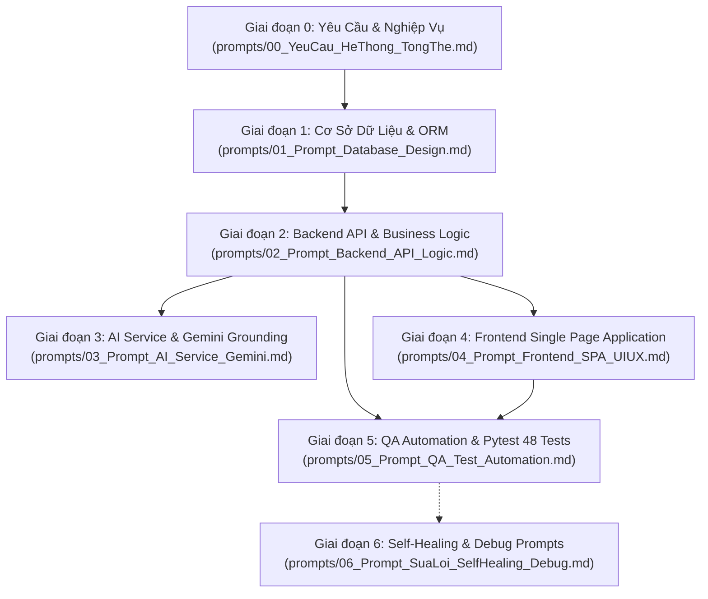

# BỘ PROMPT & ĐẶC TẢ TÁI LẬP HỆ THỐNG VIETJOURNEY AI TỪ CON SỐ 0
## (COMPLETE REBUILD BLUEPRINT & AGENTIC PROMPT SUITE)

> **Mục tiêu**: Bộ tài liệu này được thiết kế để bất kỳ lập trình viên hoặc người dùng nào khi sở hữu khung thư mục dự án này đều có thể nạp tuần tự cho một AI (Cursor, Claude, ChatGPT, Gemini, Antigravity) để tái tạo chính xác 100% hệ thống Quản lý Tour Du lịch Tích hợp AI (VietJourney AI) từ con số 0 mà không gặp lỗi ảo giác hay đứt gãy kiến trúc.

---

## 1. Bản Đồ Quy Trình Tái Tạo Hệ Thống (Rebuild Roadmap)

Quy trình phát triển được phân rã thành **7 giai đoạn chuẩn GenAI SDLC**, đi từ đặc tả nghiệp vụ, cơ sở dữ liệu, backend API, trí tuệ nhân tạo, giao diện người dùng, kiểm thử tự động, đến bộ prompt tự sửa lỗi (Self-Healing):

---

## 2. Danh Mục Tài Liệu & File Prompt Chi Tiết

| Tệp Prompt | Vai trò Agent | Mục tiêu & Sản phẩm đầu ra |
| :--- | :--- | :--- |
| **[`00_YeuCau_HeThong_TongThe.md`](file:///c:/Users/OMEN/Desktop/pj/tourdulichAI/prompts/00_YeuCau_HeThong_TongThe.md)** | `Product Owner & Lead BA` | Toàn văn đặc tả bài toán, 8 module nghiệp vụ, 3 tính năng AI, luồng người dùng và tech stack bắt buộc. |
| **[`01_Prompt_Database_Design.md`](file:///c:/Users/OMEN/Desktop/pj/tourdulichAI/prompts/01_Prompt_Database_Design.md)** | `Lead Database Architect` | Yêu cầu AI sinh 9 bảng CSDL SQLAlchemy 2.0, chuẩn hóa tiền VNĐ số nguyên, mã token Magic Link, file `models.py`, `database.py`, `seed_data.py`. |
| **[`02_Prompt_Backend_API_Logic.md`](file:///c:/Users/OMEN/Desktop/pj/tourdulichAI/prompts/02_Prompt_Backend_API_Logic.md)** | `Senior Backend Engineer` | Yêu cầu AI code FastAPI, 6 trạng thái đơn tour, cọc 30%, chống Overbooking nguyên tử, hoàn tiền bậc thang, tránh trùng lịch HDV, VietQR và gửi mail SMTP. |
| **[`03_Prompt_AI_Service_Gemini.md`](file:///c:/Users/OMEN/Desktop/pj/tourdulichAI/prompts/03_Prompt_AI_Service_Gemini.md)** | `Senior AI Engineer` | Yêu cầu AI tích hợp Gemini 2.5 Flash: Chatbot Grounding CSDL chống ảo giác, Sinh nội dung tour JSON an toàn, Phân tích cảm xúc phản hồi và Fallback Engine cục bộ. |
| **[`04_Prompt_Frontend_SPA_UIUX.md`](file:///c:/Users/OMEN/Desktop/pj/tourdulichAI/prompts/04_Prompt_Frontend_SPA_UIUX.md)** | `Senior UI/UX Engineer` | Yêu cầu AI code Single Page App thuần (Vanilla JS/CSS), Dark/Light Mode, Quick Role Switcher, Magic Link tra cứu không cần login, chống XSS DOMPurify. |
| **[`05_Prompt_QA_Test_Automation.md`](file:///c:/Users/OMEN/Desktop/pj/tourdulichAI/prompts/05_Prompt_QA_Test_Automation.md)** | `Lead QA Automation` | Yêu cầu AI viết bộ test tự động Pytest (48 test cases bao phủ Happy Path, Concurrency, RBAC, Refund, AI Fallback) và bộ query SQL kiểm tra CSDL. |
| **[`06_Prompt_SuaLoi_SelfHealing_Debug.md`](file:///c:/Users/OMEN/Desktop/pj/tourdulichAI/prompts/06_Prompt_SuaLoi_SelfHealing_Debug.md)** | `Debugging Specialist` | Bộ prompt thực chiến "bắt bệnh" và sửa ngay 6 lỗi kinh điển: Overbooking race condition, Trùng lịch HDV, Sai hoàn tiền, Crash JSON LLM, Kẹt Modal overlay, Dark mode. |

---

## 3. Hướng Dẫn Vận Hành Prompt Cho Người Dùng Mới (How To Use)

Khi bắt đầu một dự án mới từ khung thư mục trống:

1. **Bước 1 - Khởi tạo môi trường**:
   Cài đặt Python 3.10+, tạo môi trường ảo `.venv`, cài các gói trong `requirements.txt`.
2. **Bước 2 - Nạp theo thứ tự**:
   - Gửi file `prompts/00_YeuCau_HeThong_TongThe.md` vào AI làm ngữ cảnh bài toán.
   - Copy nội dung trong `prompts/01_Prompt_Database_Design.md` yêu cầu AI sinh mã nguồn CSDL và chạy `seed_data.py`.
   - Copy nội dung trong `prompts/02_Prompt_Backend_API_Logic.md` yêu cầu AI sinh toàn bộ CRUD và Routers.
   - Copy nội dung trong `prompts/03_Prompt_AI_Service_Gemini.md` yêu cầu AI xây dựng module AI chống ảo giác.
   - Copy nội dung trong `prompts/04_Prompt_Frontend_SPA_UIUX.md` yêu cầu AI dựng giao diện Web tương tác.
   - Copy nội dung trong `prompts/05_Prompt_QA_Test_Automation.md` yêu cầu AI chạy test Pytest đến khi đạt 100% Passed.
3. **Bước 3 - Xử lý lỗi phát sinh (Self-Healing)**:
   Nếu trong quá trình chạy thử hoặc kiểm thử gặp các ca biên (race condition, overbooking, lỗi modal, lỗi parse JSON của Gemini), tra cứu và copy ngay prompt tương ứng trong `prompts/06_Prompt_SuaLoi_SelfHealing_Debug.md` gửi cho AI để fix mã nguồn ngay lập tức.

---

> [!TIP]
> Để hiểu sâu hơn về kiến trúc tác tử và kỹ thuật phân tầng ngữ cảnh (Context Engineering) phục vụ báo cáo với giảng viên hoặc doanh nghiệp, hãy tham khảo thêm thư mục [`skill/`](file:///c:/Users/OMEN/Desktop/pj/tourdulichAI/skill/README.md) và cẩm nang [`07_HuongDan_NapTaiLieu_Va_VibeCoding.md`](file:///c:/Users/OMEN/Desktop/pj/tourdulichAI/skill/07_HuongDan_NapTaiLieu_Va_VibeCoding.md).

