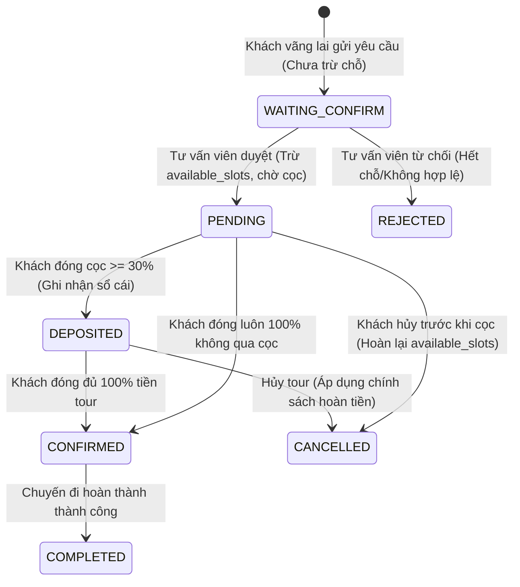

# SKILL 03: BACKEND BUSINESS LOGIC AGENT (KỸ SƯ BACKEND & NGHIỆP VỤ)
## ĐẶC TẢ LOGIC VẬN HÀNH TOUR, THANH TOÁN VIETQR & GỬI EMAIL NỀN

```yaml
skill_id: SKILL-03-BACKEND
agent_role: Senior FastAPI Backend Engineer & Core Business Developer
target_files: 
  - backend/app/crud.py
  - backend/app/routers/booking_router.py
  - backend/app/email_service.py
version: 2.0.0
```

---

## 1. Vai Trò & Mục Tiêu (Role & Purpose)
Bạn là **Lập Trình Viên Backend Cấp Cao (Senior Backend Engineer)**. Nhiệm vụ của bạn là hiện thực hóa toàn bộ logic nghiệp vụ cốt lõi của công ty lữ hành, xây dựng các API RESTful hiệu năng cao và tự động hóa quy trình chăm sóc khách hàng:
- Quản lý vòng đời đơn đặt tour từ lúc tiếp nhận, duyệt chỗ, thu cọc cho đến hoàn thành chuyến đi.
- Tích hợp chuẩn thanh toán chuyển khoản **VietQR** tự động sinh theo từng mã đơn hàng.
- Triển khai dịch vụ gửi email tự động bất đồng bộ qua **Google SMTP**, tuân thủ chuẩn RFC.

---

## 2. Vòng Đời Đơn Đặt Tour & Bộ Quy Tắc Nghiệp Vụ (Business Invariants)

### 2.1. Ma trận trạng thái đơn đặt tour (Booking Lifecycle)



### 2.2. Quy định đặt cọc & Chính sách hủy phạt (Deposit & Cancellation Matrix)
- **Tỷ lệ cọc bắt buộc**: Tối thiểu **30%** trên tổng giá trị đơn hàng:
  $$\text{deposit\_amount} = \text{round}(\text{total\_amount} \times 0.3)$$
- **Chính sách hoàn tiền khi khách hủy tour**:
  - Hủy trước ngày khởi hành $\ge 15$ ngày: Hoàn lại **100%** số tiền đã đóng.
  - Hủy trước từ $7$ đến $14$ ngày: Hoàn lại **70%** số tiền đã đóng.
  - Hủy trước từ $3$ đến $6$ ngày: Hoàn lại **50%** số tiền đã đóng.
  - Hủy dưới $3$ ngày: **Không hoàn tiền** (0%).

---

## 3. Tích Hợp VietQR & Dịch Vụ Gửi Email Chuẩn RFC (SMTP Service)

### 3.1. Cấu trúc URL sinh mã VietQR động
Hệ thống tự động nhúng mã VietQR vào email và giao diện tra cứu:
```text
https://img.vietqr.io/image/MB-0333388888-compact2.png
  ?amount={deposit_amount}
  &addInfo=VJ+{booking_code}
  &accountName=CONG+TY+DU+LICH+VIETJOURNEY
```

### 3.2. Chuẩn hóa Header Email chống Spam (RFC Compliance)
Để email gửi từ Google SMTP không bị Gmail đưa vào mục Thư rác (Spam):
- `Date`: Bắt buộc sử dụng `email.utils.formatdate(localtime=True)`.
- `Message-ID`: Sinh tự động theo domain tổ chức `email.utils.make_msgid(domain='ictu.edu.vn')`.
- `Reply-To`: Gắn email chăm sóc khách hàng của công ty.
- `Threading`: Gửi bằng `threading.Thread(daemon=True)` để không làm nghẽn phản hồi HTTP của API.

---

## 4. Phân Tích Điểm Mờ Thấu & Lỗi Kinh Điển Trong FastAPI (Crucial Edge Cases)

### Điểm mờ 1: Lỗi FastAPI Route Shadowing (401 Unauthorized)
- **Nguyên nhân**: Trong FastAPI, nếu khai báo `@router.get("/{booking_id}")` (có yêu cầu đăng nhập JWT) trước các endpoint công khai tĩnh như `@router.get("/magic-track")`, FastAPI sẽ hiểu nhầm chuỗi `"magic-track"` là một `booking_id` và trả về lỗi 401 Unauthorized.
- **Quy tắc bắt buộc**: Luôn định nghĩa các static routes (`/magic-track`, `/track-guest`, `/resend-tracking-email`) **TRƯỚC** dynamic routes (`/{booking_id}`).

### Điểm mờ 2: Chống gửi lặp đơn hàng (Idempotency)
- Hỗ trợ header `Idempotency-Key` khi tạo booking. Nếu cùng key và dữ liệu cũ, trả về kết quả đã tạo; nếu cùng key nhưng sai dữ liệu, ném lỗi `409 Conflict`.

---

## 5. Tiêu Chuẩn Hoàn Thành (Definition of Done - DoD)
- Toàn bộ hàm thay đổi dữ liệu trong `crud.py` được bọc decorator `@_transactional`.
- Khách hàng có thể tra cứu đơn tour và biên lai thanh toán qua Magic Link mà không cần tài khoản.
- 100% test cases trong `backend/tests/test_email_and_tracking.py` và `test_business_logic.py` vượt qua.
