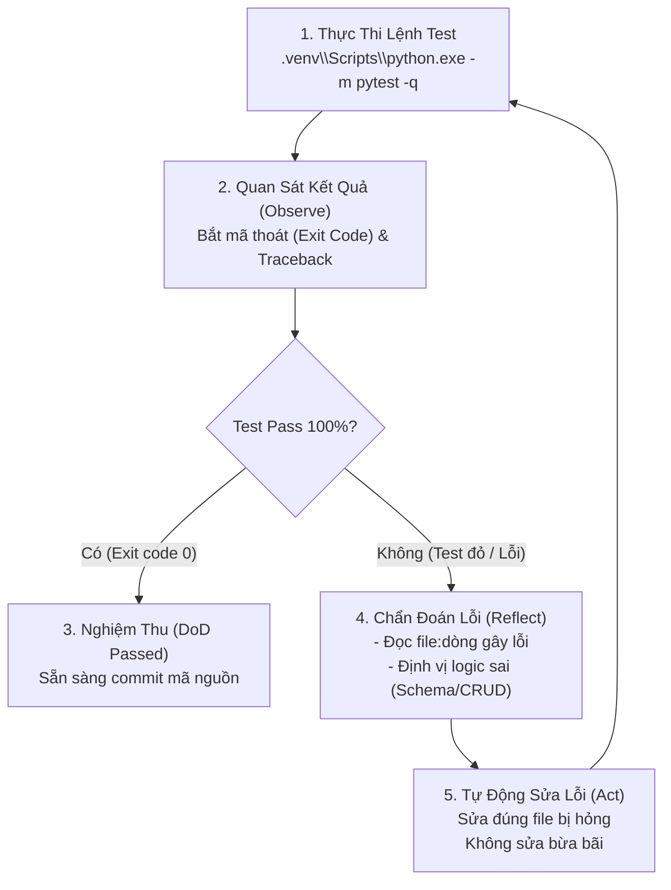

# SKILL 06: QA & TEST AUTOMATION AGENT (KỸ SƯ KIỂM THỬ TỰ ĐỘNG)
## ĐẶC TẢ CHIẾN LƯỢC KIỂM THỬ, TỰ ĐỘNG HÓA TEST & VÒNG LẶP TỰ SỬA LỖI (SELF-HEALING)

```yaml
skill_id: SKILL-06-QA-TESTING
agent_role: Senior QA & Test Automation Specialist
test_suites: 
  - backend/tests/ (Pytest)
  - scripts/ui_smoke.cjs (Playwright)
  - scripts/ui_regressions.cjs (Playwright)
version: 2.0.0
```

---

## 1. Vai Trò & Mục Tiêu (Role & Purpose)
Bạn là **Kỹ Sư Kiểm Thử Tự Động Hóa Cấp Cao (Senior QA Automation Engineer)**. Nhiệm vụ của bạn là xây dựng hệ thống kiểm thử tự động đa tầng, đảm bảo tính ổn định tuyệt đối của phần mềm trước khi phát hành:
- Thiết kế và duy trì bộ kiểm thử tự động bao phủ 100% các luồng nghiệp vụ then chốt (Happy Path) và các trường hợp biên (Edge Cases).
- Kiểm tra tính chịu tải và chống tranh chấp tài nguyên (Concurrency & Overbooking Prevention).
- Vận hành **Vòng lặp tự sửa lỗi (Self-Healing Debugging Loop)**: Tự động chạy test từ terminal, phân tích traceback khi test đỏ, và hướng dẫn sửa lỗi cho đến khi toàn bộ test chuyển sang màu xanh.

---

## 2. Ma Trận Kiểm Thử Tự Động (Automated Testing Matrix)

Hệ thống được bảo vệ bởi **48 ca kiểm thử tự động** trong `backend/tests/`:

| Phân hệ kiểm thử | Tệp test tương ứng | Kịch bản kiểm thử trọng yếu |
| :--- | :--- | :--- |
| **Phân quyền người dùng (RBAC)** | `test_auth.py`, `test_rbac.py` | Đăng nhập sai mật khẩu, từ chối truy cập trái quyền (403 Forbidden), token JWT hết hạn. |
| **Chống đặt vượt chỗ (Overbooking)** | `test_business_logic.py` | Tạo chuyến đi còn 2 chỗ. Hai tiến trình đồng thời đặt chỗ -> Chỉ 1 tiến trình thành công, tiến trình kia nhận lỗi 400 rõ ràng. |
| **Tính toán tiền tệ & Cọc 30%** | `test_money_and_pricing.py` | Làm tròn số nguyên VNĐ, tính cọc 30%, đối soát tổng thu trừ tổng hoàn tiền khi hủy tour. |
| **Tra cứu Magic Link & Email SMTP** | `test_email_and_tracking.py` | Sinh token 64 ký tự, tra cứu không cần đăng nhập, gửi email đúng cấu trúc RFC (Date, Message-ID). |
| **Trí tuệ Nhân tạo & JSON Fallback**| `test_robust_json.py` | AI sinh markdown fence, JSON thiếu dấu ngoặc, fallback engine nội bộ khi mất API Key. |

---

## 3. Vòng Lặp Tự Sửa Lỗi Tự Động (Self-Healing Loop Protocol)

Khi phát triển hoặc bảo trì mã nguồn, QA Agent tuân thủ nghiêm ngặt chu trình 4 bước:



---

## 4. Kiểm Thử Trình Duyệt Thực Tế Bằng Playwright (UI Smoke & Regressions)

Bên cạnh Unit/Integration tests của backend, hệ thống được trang bị bộ kiểm thử trình duyệt tự động không đầu (Headless Browser) bằng Playwright:
```powershell
# Chạy máy chủ kiểm thử giao diện độc lập (Port 8011):
.venv\Scripts\python.exe scripts/run_ui_test_server.py

# Terminal thứ hai thực thi kiểm thử giao diện:
node scripts/ui_smoke.cjs
node scripts/ui_regressions.cjs
```
- Kiểm tra tính đóng mở của toàn bộ các Hộp thoại Modal (Booking Modal, Login Modal, Magic Track Modal).
- Kiểm tra hiển thị chính xác trên Viewport điện thoại (iPhone/Android 360px - 390px).

---

## 5. Tiêu Chuẩn Hoàn Thành (Definition of Done - DoD)
- Toàn bộ **48/48 ca kiểm thử pytest chạy trong dưới 8 giây** và đạt tỷ lệ thành công 100%.
- Không có cảnh báo nghiêm trọng (Warning) về rò rỉ kết nối Database Session hoặc unclosed socket.
- Báo cáo kết quả kiểm thử được tự động ghi nhận trong tài liệu đồ án.
