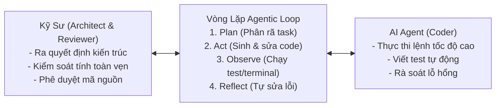
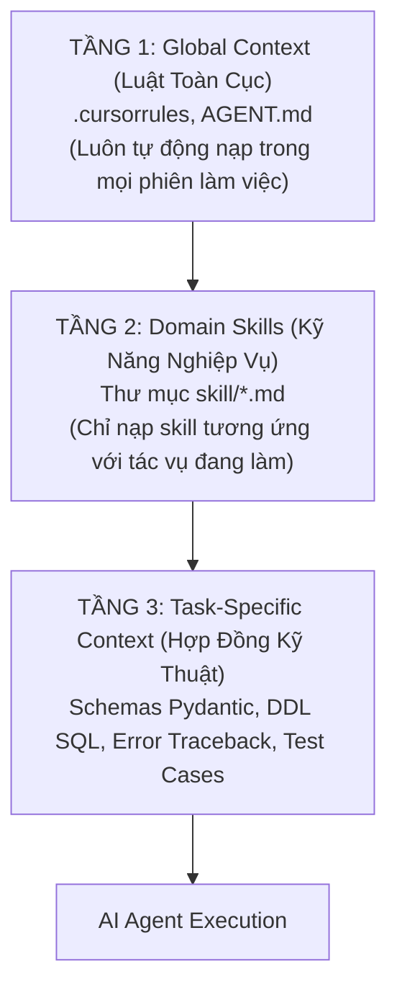

# CẨM NANG VIBE CODING & GIAO TIẾP VỚI AI AGENT CHUẨN CÔNG NGHIỆP
## HƯỚNG DẪN QUẢN TRỊ NGỮ CẢNH (CONTEXT ENGINEERING) & PHỤC VỤ BẢO VỆ ĐỒ ÁN

---

## 1. Bản Chất Của "Vibe Coding Chuyên Nghiệp" (Vibe Coding vs. Amateurs)

Trong môi trường kỹ thuật hiện đại, **Vibe Coding chuyên nghiệp** không phải là việc gõ prompt ngẫu nhiên rồi copy-paste mã nguồn. 
Đây là phương pháp luận **Spec-Driven Development (Phát triển hướng đặc tả)** kết hợp với **Agentic Engineering (Kỹ thuật điều phối tác tử)**:



- **Vai trò con người**: Kiến trúc sư trưởng (Software Architect) — định nghĩa bài toán, đặt ra các luật bất biến (Invariants), nghiệm thu kết quả.
- **Vai trò AI Agent**: Lập trình viên tốc độ cao (High-Velocity Implementer) — hiện thực hóa mã nguồn, viết test tự động, đọc log và tự động sửa lỗi (Self-Healing).

---

## 2. Cách Gửi Tài Liệu Thiết Kế & Kỹ Thuật Cho AI Chuẩn Xác (Context Engineering)

Sai lầm phổ biến nhất của sinh viên là copy toàn bộ file Word 50-100 trang paste vào khung chat. Điều này gây ra hiện tượng **Tràn cửa sổ ngữ cảnh (Context Rot)** và **Pha loãng sự chú ý (Attention Dilution)**, khiến AI sinh ảo giác (chế sai bảng DB, sai tên cột, sai API).

Chuẩn công nghiệp áp dụng mô hình **Phân Tầng Ngữ Cảnh (Tiered Context Architecture)**:



### 2.1. Quy tắc gửi tài liệu thiết kế CSDL (Database Specs)
- **Không gửi**: Đoạn văn xuôi mô tả chung chung.
- **Phải gửi**: Bản trích xuất SQL DDL hoặc Schema Pydantic/SQLAlchemy có đầy đủ kiểu dữ liệu, ràng buộc khóa ngoại, Index và quy ước tiền tệ:
  ```python
  # Ví dụ gửi ngữ cảnh đúng:
  # Cung cấp trực tiếp models.Booking kèm ràng buộc:
  # access_token VARCHAR(64) UNIQUE, deposit_amount = 30% total_amount
  ```

### 2.2. Quy tắc gửi tài liệu API & Nghiệp vụ (API Contracts)
- Gửi theo chuẩn **Contract-First**: Khai báo trước Input Schema và Output Schema (Pydantic DTOs).
- Ràng buộc mã lỗi HTTP (400 Bad Request nếu hết chỗ, 404 Not Found nếu sai mã đơn, 409 Conflict nếu trùng lặp).

### 2.3. Quy tắc gửi lỗi khi Debug (Error & Traceback Feeding)
- Khi gặp lỗi, không hỏi *"Tại sao code của tôi không chạy?"*.
- Cung cấp đủ 3 thành phần:
  1. **Lệnh vừa thực thi** (Command line).
  2. **Toàn bộ stack trace / log lỗi** từ terminal.
  3. **Đoạn code nghi ngờ gây lỗi** (đính kèm đường dẫn file cụ thể).

---

## 3. Cấu Trúc Thiết Kế Một "Skill" Chuẩn Công Nghiệp

Một Skill trong hệ thống tác tử hiện đại được chuẩn hóa theo 6 phần bắt buộc:

| Thành phần | Ý nghĩa kỹ thuật | Ví dụ trong dự án VietJourney |
| :--- | :--- | :--- |
| **1. Metadata & Role** | Định danh vai trò chuyên gia của Agent | `Senior FastAPI Backend Engineer` |
| **2. Context Prerequisites** | Tài liệu thiết kế bắt buộc Agent phải đọc | `models.py`, `schemas.py`, bảng giá tour |
| **3. Strict Invariants** | Các luật cấm kỵ KHÔNG ĐƯỢC PHÉP vi phạm | Không overbooking, cọc đúng 30%, tiền VNĐ số nguyên |
| **4. Ambiguity & Edge Cases** | Phân tích các điểm mờ và trường hợp ngoại lệ | Khách hủy sát ngày, 2 khách đặt cùng 1 chỗ cuối |
| **5. Step-by-Step Protocol** | Trình tự các bước thực thi mã nguồn | 1. Tạo schema -> 2. Viết CRUD -> 3. Viết Router |
| **6. Definition of Done (DoD)** | Tiêu chuẩn nghiệm thu kỹ thuật | Chạy `pytest` 100% Passed, code có logging |

---

## 4. Bộ Câu Hỏi & Câu Trả Lời Khi Giảng Viên Sát Hạch

Khi bảo vệ đồ án, giảng viên thường đặt các câu hỏi cốt lõi sau để kiểm tra bạn có thực sự hiểu về AI Agent hay chỉ "copy-paste mã":

### Câu 1: "Em sử dụng AI Agent như thế nào trong dự án này?"
- **Trả lời**: 
  > *"Thưa thầy/cô, em không sử dụng AI như một chatbot hỏi đáp thông thường, mà áp dụng theo mô hình **Multi-Agent Task Decomposition (Phân rã tác vụ theo chuyên gia)**. Em thiết kế 6 Agent độc lập tương ứng với các giai đoạn SDLC:
  > 1. **Architect Agent**: Thiết kế kiến trúc phân tầng và luồng dữ liệu.
  > 2. **Database Agent**: Thiết kế ERD, ràng buộc toàn vẹn và kiểu dữ liệu tiền tệ.
  > 3. **Backend Agent**: Hiện thực hóa nghiệp vụ đặt cọc 30%, chống overbooking, sinh mã VietQR và gửi mail SMTP nền.
  > 4. **AI Engineer Agent**: Tích hợp Google Gemini với cơ chế Grounding CSDL chống ảo giác.
  > 5. **Frontend Agent**: Xây dựng SPA giao diện hiện đại với Magic Link tra cứu không cần đăng nhập.
  > 6. **QA Automation Agent**: Tự động sinh và chạy 48 ca kiểm thử pytest."*

### Câu 2: "Skill của em được thiết kế như thế nào? Tại sao cần có Skill?"
- **Trả lời**:
  > *"Dạ thưa thầy/cô, nếu chỉ ra lệnh chung chung, AI sẽ sinh code lộn xộn và không đồng nhất. Vì vậy, em đã chuẩn hóa các **Skill** đóng vai trò là 'hợp đồng kỹ thuật' cho từng Agent. Mỗi file skill trong thư mục `skill/` đều có:
  > - **Frontmatter & Role**: Xác định vai trò chuyên gia.
  > - **Bộ luật bất biến (Strict Invariants)**: Ngăn chặn triệt để các lỗi nghiệp vụ nghiêm trọng.
  > - **Phân tích điểm mờ (Ambiguity Analysis)**: Dự báo các ca biên (Edge cases) như tranh chấp ghế, thanh toán thiếu tiền.
  > - **Definition of Done**: Định nghĩa rõ ràng khi nào tác vụ được coi là hoàn thành."*

### Câu 3: "Làm thế nào em kiểm soát được hiện tượng AI sinh ảo giác (Hallucination)?"
- **Trả lời**:
  > *"Em kiểm soát ảo giác ở 2 cấp độ:
  > 1. **Ở cấp độ phát triển mã nguồn**: Em dùng kỹ thuật **Spec-Driven Prompting**, cung cấp sẵn Pydantic Schema và kiểu dữ liệu, buộc AI phải trả về kết quả tuân thủ đúng Interface, không được tự bịa ra thuộc tính mới.
  > 2. **Ở cấp độ tính năng ứng dụng (Chatbot tư vấn tour)**: Em áp dụng cơ chế **Database Grounding**. Trước khi gọi Gemini API, hệ thống truy vấn cơ sở dữ liệu để lấy danh sách các tour CÒN CHỖ THỰC TẾ đưa vào Prompt. Hệ thống cấm AI gợi ý tour không có trong danh sách CSDL cung cấp."*

### Câu 4: "Quy trình em gửi tài liệu thiết kế cho AI trong dự án diễn ra như thế nào?"
- **Trả lời**:
  > *"Em quản trị ngữ cảnh theo mô hình **Tiered Context**:
  > - Em cấu hình sẵn file [`.cursorrules`](file:///c:/Users/OMEN/Desktop/pj/tourdulichAI/.cursorrules) và [`AGENT.md`](file:///c:/Users/OMEN/Desktop/pj/tourdulichAI/AGENT.md) ở thư mục gốc chứa các quy tắc toàn dự án (Tech stack, coding standard, commands).
  > - Khi làm phân hệ nào, em chỉ nạp tài liệu thiết kế của phân hệ đó (ví dụ làm thanh toán cọc thì nạp `skill/03_Backend_NghiepVu_API_Agent.md` và `models.Booking`).
  > - Em dùng cú pháp tham chiếu file trực tiếp (`@file`) để AI đọc đúng mã nguồn hiện tại, tránh paste văn bản thô gây loãng ngữ cảnh."*
