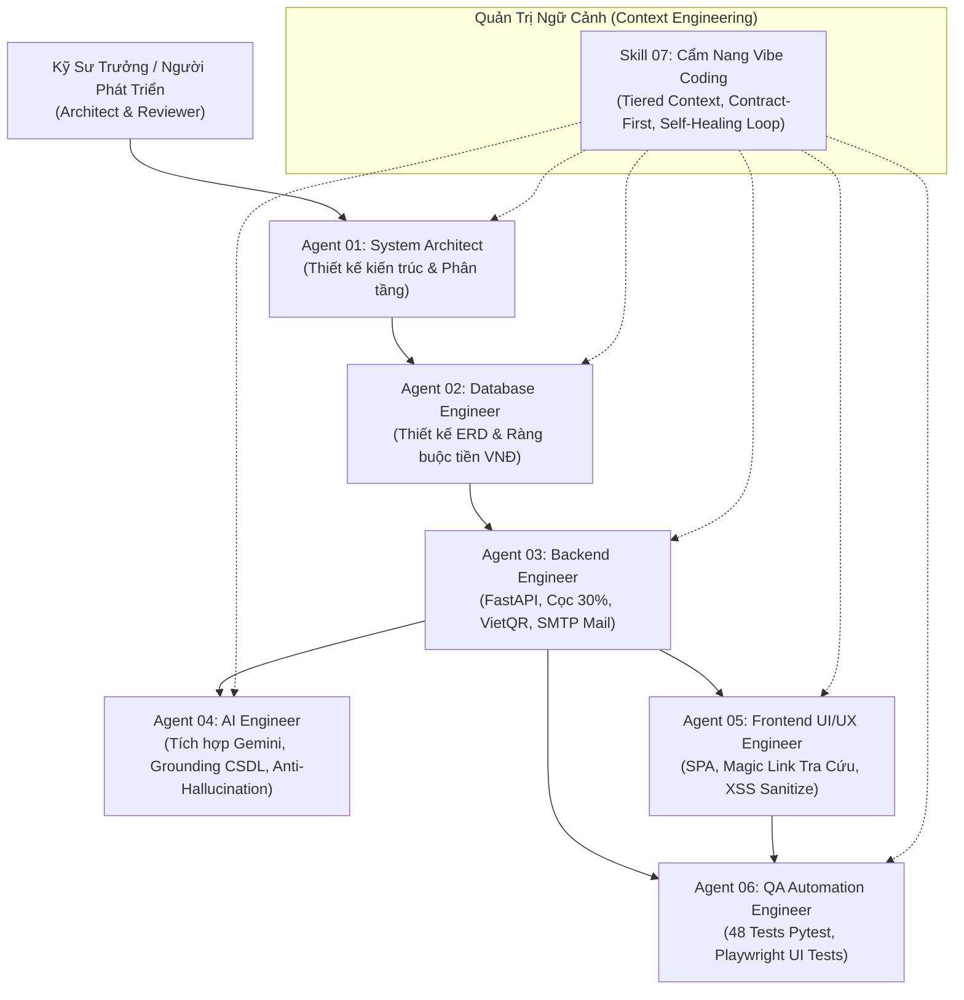

# HỆ THỐNG SKILLS & ĐIỀU PHỐI TÁC TỬ AI (MULTI-AGENT ARCHITECTURE)
## DÀNH CHO PHÁT TRIỂN VIBE CODING CHUẨN CÔNG NGHIỆP & BẢO VỆ ĐỒ ÁN

---

## 1. Tổng Quan Kiến Trúc Tác Tử Đa Nhiệm (Multi-Agent System Overview)

Trong dự án **VietJourney AI**, hệ thống không sử dụng AI như một chatbot hỏi đáp rời rạc, mà vận hành theo mô hình **Multi-Agent Task Decomposition (Phân rã tác vụ theo chuyên gia)**. Mỗi Agent đại diện cho một vai trò kỹ sư chuyên sâu trong vòng đời phát triển phần mềm (SDLC):

---

## 2. Danh Mục Các Skills Đã Chuẩn Hóa

Toàn bộ 8 tệp kỹ năng trong thư mục này được xây dựng theo chuẩn công nghiệp (Frontmatter, Invariants, Ambiguity Analysis, Execution Protocol, Definition of Done):

| Tệp Skill | Định danh Skill | Vai trò của Agent (Role) | Trọng tâm nghiệp vụ & Ràng buộc kỹ thuật |
| :--- | :--- | :--- | :--- |
| **[`00_KhaoSat_NghiepVu.md`](file:///c:/Users/OMEN/Desktop/pj/tourdulichAI/skill/00_KhaoSat_NghiepVu.md)** | `SKILL-00-REQ` | Business Analyst (BA) | Khảo sát bài toán lữ hành thực tế, luồng đặt tour, thu cọc và nhu cầu ứng dụng AI. |
| **[`01_System_Architecture_Agent.md`](file:///c:/Users/OMEN/Desktop/pj/tourdulichAI/skill/01_System_Architecture_Agent.md)** | `SKILL-01-ARCH` | Lead System Architect | Thiết kế kiến trúc phân tầng Clean Architecture, Compound AI System, phân tách Presentation/Core/AI. |
| **[`02_Database_Design_Agent.md`](file:///c:/Users/OMEN/Desktop/pj/tourdulichAI/skill/02_Database_Design_Agent.md)** | `SKILL-02-DB` | Lead Database Architect | Thiết kế 9 thực thể CSDL, chuẩn hóa tiền tệ số nguyên VNĐ, sinh token `access_token` cho Magic Link. |
| **[`03_Backend_Business_Logic_Agent.md`](file:///c:/Users/OMEN/Desktop/pj/tourdulichAI/skill/03_Backend_Business_Logic_Agent.md)** | `SKILL-03-BACKEND` | Senior Backend Engineer | Vòng đời đơn đặt tour (6 trạng thái), luật cọc 30%, trừ chỗ chống overbooking, sinh mã VietQR và gửi mail SMTP nền. |
| **[`04_AI_Engineering_Gemini_Agent.md`](file:///c:/Users/OMEN/Desktop/pj/tourdulichAI/skill/04_AI_Engineering_Gemini_Agent.md)** | `SKILL-04-AI` | Senior AI Engineer | Cơ chế Grounding CSDL chống ảo giác cho chatbot tư vấn, parser JSON siêu bền vững, Fallback Engine nội bộ. |
| **[`05_Frontend_UIUX_SPA_Agent.md`](file:///c:/Users/OMEN/Desktop/pj/tourdulichAI/skill/05_Frontend_UIUX_SPA_Agent.md)** | `SKILL-05-FRONTEND` | Senior UI/UX Engineer | Kiến trúc SPA không framework nặng, Dark/Light mode, tra cứu đơn tour tự động qua Magic Link và lọc XSS DOMPurify. |
| **[`06_QA_Test_Automation_Agent.md`](file:///c:/Users/OMEN/Desktop/pj/tourdulichAI/skill/06_QA_Test_Automation_Agent.md)** | `SKILL-06-QA` | QA Automation Engineer | Bộ 48 test suites Pytest đạt 100%, kịch bản test concurrency, kiểm thử trình duyệt không đầu Playwright. |
| **[`07_HuongDan_NapTaiLieu_Va_VibeCoding.md`](file:///c:/Users/OMEN/Desktop/pj/tourdulichAI/skill/07_HuongDan_NapTaiLieu_Va_VibeCoding.md)** | `SKILL-07-GUIDE` | AI-Native Methodologist | **Cẩm nang bảo vệ đồ án**: Kỹ thuật phân tầng ngữ cảnh (Tiered Context), Spec-Driven Prompting, giải trình với Giảng viên. |

> [!NOTE]
> **Bộ Prompt Thực Thi Tái Tạo Hệ Thống Từ Đầu**:
> Nếu bạn hoặc một lập trình viên khác muốn lấy các prompt cụ thể để nạp trực tiếp cho AI (Cursor, ChatGPT, Claude, Gemini) sinh code từng module từ đầu, hãy mở thư mục **[`prompts/`](file:///c:/Users/OMEN/Desktop/pj/tourdulichAI/prompts/README.md)** (bao gồm từ Prompt 00 đến Prompt 06 và bộ prompt tự sửa lỗi Self-Healing).

---

## 3. Bản Hướng Dẫn Trả Lời Khi Giảng Viên Đặt Câu Hỏi

### Câu hỏi 1: "Em sử dụng Agent như thế nào trong dự án này?"
- **Cách trả lời tự tin**:
  > *"Em áp dụng quy trình **Agentic Engineering** phân rã theo 6 vai trò chuyên gia độc lập (Architect, Database, Backend, AI, Frontend, QA). Thay vì yêu cầu AI viết toàn bộ hệ thống trong một lệnh, em điều phối từng Agent theo chu trình **Spec -> Code -> Test -> Self-Healing**:
  > - Agent Database thiết kế schema và sinh migration.
  > - Agent Backend nhận schema đó để xây dựng API và bọc giao dịch chống overbooking.
  > - Agent QA tự chạy terminal `pytest`, bắt lỗi traceback và tự sửa code cho đến khi 100% test case chuyển sang màu xanh."*

### Câu hỏi 2: "Skill của em được thiết kế như thế nào? Cấu trúc ra sao?"
- **Cách trả lời**:
  > *"Skill không phải là một đoạn prompt tùy tiện, mà là một **Hợp đồng kỹ thuật (Technical Contract)** chuẩn hóa gồm 6 phần:
  > 1. **Metadata & Role**: Định danh vai trò chuyên gia cấp cao.
  > 2. **Context Prerequisites**: Các tài liệu thiết kế bắt buộc Agent phải đọc trước khi code.
  > 3. **Strict Invariants**: Bộ luật bất biến cấm kỵ (ví dụ: cọc đúng 30%, tiền VNĐ số nguyên, không được tự bịa giá tour).
  > 4. **Ambiguity Analysis**: Dự báo các ca biên (Edge cases) như tranh chấp ghế hoặc lỗi mail.
  > 5. **Execution Protocol**: Quy trình từng bước thực thi.
  > 6. **Definition of Done (DoD)**: Tiêu chuẩn nghiệm thu kỹ thuật (100% test passed, có logging)."*

### Câu hỏi 3: "Cách gửi cho AI tài liệu thiết kế, kỹ thuật chuẩn Vibe Coding chuyên nghiệp là gì?"
- **Cách trả lời**:
  > *"Dạ thưa thầy/cô, em áp dụng kỹ thuật **Context Engineering (Quản trị ngữ cảnh)** theo mô hình 3 tầng (Tiered Context):
  > - **Tầng 1 (Global Context)**: Cấu hình sẵn trong [`.cursorrules`](file:///c:/Users/OMEN/Desktop/pj/tourdulichAI/.cursorrules) và [`AGENT.md`](file:///c:/Users/OMEN/Desktop/pj/tourdulichAI/AGENT.md) để AI luôn ghi nhớ tech stack, quy chuẩn code và lệnh chạy test.
  > - **Tầng 2 (Domain Skills)**: Nạp các file trong thư mục `skill/` tương ứng với phân hệ đang làm việc.
  > - **Tầng 3 (Task Spec / Contract)**: Gửi giao diện Pydantic Schema, SQL DDL hoặc Unit Test fail thay vì paste văn bản văn xuôi dài dòng.
  > Cách làm này giúp tránh hiện tượng **Context Rot (Tràn cửa sổ ngữ cảnh)** và **Attention Dilution (Pha loãng chú ý)**, giúp AI tập trung 100% vào việc sinh mã nguồn chính xác."*
